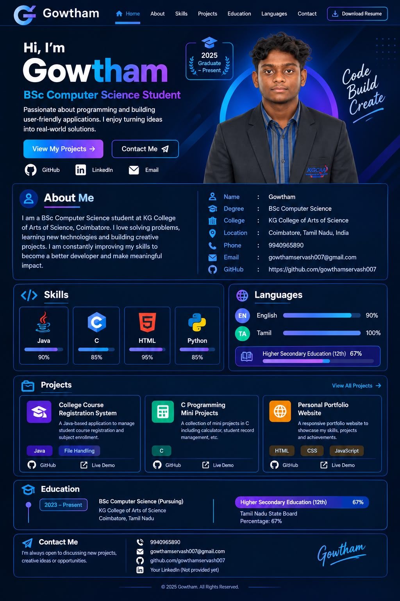

# Gowtham - Personal Developer Portfolio 🚀

A modern, responsive, cyber-dark themed personal developer portfolio designed and built for **Gowtham**, BSc Computer Science student at **KG College of Arts of Science, Coimbatore**.



---

## 🌟 Features

- **Cyber Dark & Neon Aesthetic**: Custom deep space navy theme with glowing neon cyan/purple accents matching the personal brand design.
- **Hero Showcase**: Features Gowtham's portrait in college blazer, status indicators, and call-to-action buttons.
- **Detailed About Me**: Clean two-column layout with biographical summary, key academic highlights, and verified contact coordinates.
- **Animated Skills Matrix**:
  - Interactive skill cards for **Java (90%)**, **C (85%)**, **HTML (95%)**, and **Python (85%)** with smooth progress animations on scroll.
- **Languages & Academic Credentials**:
  - English (90%) and Tamil (100%) proficiency bars.
  - Higher Secondary Education (12th Grade - 67%) scorecard banner.
- **Interactive Projects Suite**:
  - **College Course Registration System** (Java, File Handling) with an interactive enrollment simulation.
  - **C Programming Mini Projects** (C) with an emulated C CLI runner.
  - **Personal Portfolio Website** (HTML, CSS, JS) with Lighthouse metric badges.
- **Interactive Modals**:
  - Live interactive simulators for each project.
  - Printable / Exportable Curriculum Vitae modal with PDF-friendly print stylesheet.
- **Contact Channels**:
  - Form with instant feedback & pre-filled email launcher.
  - Quick connect buttons for WhatsApp and Direct Phone Call.
  - Gowtham's handwritten signature with glowing neon underline.
- **Mobile Responsive**: Fully adaptive layout with a slide-out drawer menu for smartphones and tablets.

---

## 📁 File Structure

```text
protfolio/
│
├── index.html              # Main HTML5 semantic portfolio page
├── style.css               # Comprehensive cyber-dark responsive styling
├── main.js                 # Interactive logic, simulators, animations & modals
├── resume.html             # Standalone printable CV page
│
├── assets/
│   └── images/
│       ├── gowtham-hero.png       # Hero section portrait graphic
│       ├── gowtham-clean.jpg      # Centered portrait
│       ├── gowtham-signature.png  # Handwritten signature
│       └── gowtham-navlogo.png    # Brand navigation logo
│
└── README.md               # Documentation
```

---

## 🚀 How to Run Locally

You can open `index.html` directly in any web browser:

1. Double-click **`index.html`** in File Explorer, or
2. Open PowerShell in this folder and run:
   ```powershell
   Start-Process index.html
   ```

To preview the standalone resume:
```powershell
Start-Process resume.html
```

---

## 🌐 Deploy to GitHub Pages (Free)

1. Create a repository on GitHub (e.g. `gowtham-portfolio` or `gowthamservash007.github.io`).
2. Push this folder to GitHub:
   ```bash
   git init
   git add .
   git commit -m "Initial release of Gowtham Portfolio"
   git branch -M main
   git remote add origin https://github.com/gowthamservash007/<repo-name>.git
   git push -u origin main
   ```
3. In your GitHub repository, navigate to **Settings > Pages** and select `Branch: main`, `/ (root)`. Your portfolio will be live in seconds!

---

## 👨‍💻 Author & Contact

- **Name:** Gowtham
- **Degree:** BSc Computer Science (Pursuing)
- **College:** KG College of Arts of Science, Coimbatore, Tamil Nadu
- **Phone:** [+91 9940965890](tel:9940965890)
- **Email:** [gowthamservash007@gmail.com](mailto:gowthamservash007@gmail.com)
- **GitHub:** [https://github.com/gowthamservash007](https://github.com/gowthamservash007)
